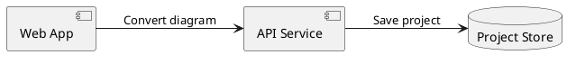

# PUML Studio

### Structure with code. Finish by hand.

Turn PlantUML into **editable nodes, connections and label boxes**. Adjust the diagram in your browser, then export SVG, PNG or a native draw.io file.

**Offline · No backend · No build step · MIT licensed**

[简体中文](README.zh-CN.md) · [Examples](examples) · [Supported syntax](docs/syntax.md) · [Edge editing](docs/edge-editing.md) · [Label boxes](docs/edge-labels.md)


## Why PUML Studio?

PlantUML makes it convenient to describe a diagram's structure. Finishing it for a document often requires moving one box, changing a connection's attachment point, or making a label fit a narrow space.

PUML Studio keeps that workflow in one local workbench:

```text
.puml → parse & lay out → drag, align & refine → SVG / PNG / .drawio
                                  ↕
                       save / open .pumlstudio
```

The resulting diagram consists of individual objects. Nodes, edge endpoints, waypoints and label boxes can all be edited independently.

> PUML Studio supports a practical **subset** of PlantUML. It builds its own diagram model and layout; it does not run the PlantUML rendering engine. See [Compatibility](#compatibility) before importing complex diagrams.

## Quick start

1. Download the source and extract the folder.
2. Open **`index.html`** in a modern desktop browser.
3. Drop a `.puml` file onto the page, paste source, or choose a built-in example.
4. Click **生成可编辑图形** to generate, then make your adjustments.
5. Save a project or export your finished diagram.

No Node.js, Java, Graphviz, API key or internet connection is needed to use the editor. The interface is currently in Chinese; screenshots and translated controls are documented below.

If your browser restricts storage or downloads for local files, run a static server from the project directory:

```bash
python3 -m http.server 8787
```

Then open **http://localhost:8787**. You can also use any other static HTTP server.

### Try this diagram



More examples: [component architecture](examples/architecture.puml), [classes](examples/classes.puml), [linear activities](examples/activity.puml).

## What you can edit

| Feature | Controls |
| --- | --- |
| Nodes | Drag, resize, change shape, color, text and class members |
| Connections | Add/remove edges; choose arrows and solid/dashed lines |
| Attachment points | Drag endpoint squares or enter node-relative X/Y percentages |
| Waypoints | Drag circles; click a segment's **+** to insert; double-click a point to remove |
| Alignment | Snap waypoints horizontally/vertically and nodes to other nodes' edges/centers |
| Labels | Drag independently, resize, edit text, enter exact position and dimensions |
| Label wrapping | Narrower boxes wrap Chinese/English text; height expands to avoid clipping |
| Label fill | Transparent by default; choose a color and background opacity |
| Canvas | Pan, zoom, fit, automatic layout, undo and redo |
| Projects | Save/open the source together with the edited diagram |

Snapping uses an **8 screen-pixel** threshold at any zoom. Purple guides appear while dragging. Hold **Alt** to bypass snapping, or toggle **吸附** in the toolbar. Numeric coordinate inputs stay exact.

<details>
<summary>See connection editing and snapping</summary>


Read the [edge editing guide](docs/edge-editing.md) for attachment coordinates, path editing and reset behavior.

</details>

<details>
<summary>See resizable label boxes and automatic wrapping</summary>


Drag the label itself to move it, or its bottom-right handle to resize it. Fill opacity affects the background only. Read the [label guide](docs/edge-labels.md).

</details>

## Save and export

| Format | Purpose |
| --- | --- |
| `.pumlstudio` | Reopen in PUML Studio; retains source, layout, endpoints, waypoints and label settings |
| `.svg` | Vector image for documents and further vector editing |
| `.png` | Image at 2× resolution |
| `.drawio` | Native nodes, edges and label cells for continued editing in diagrams.net |

Use **保存项目** to save and **打开项目** to reopen. The **导出图形** menu offers SVG, PNG and draw.io. SVG/PNG use the current editor layout and line wrapping; exported bounds include labels moved away from their connections.

**Manual edits do not rewrite `.puml` source.** Generating from source again rebuilds the diagram and resets manual edits. Save `.pumlstudio` to keep working on your adjusted version. SVG, PNG and draw.io files are exports; they are not project imports for this editor.

A browser-local draft is saved when storage is available. Clearing browser data removes that draft; save important work as a project file. Storage behavior under `file://` varies between browsers.

## Compatibility

| Input | Current behavior |
| --- | --- |
| Component/deployment relationships | Common node declarations, aliases and connections become editable objects |
| Class diagrams | Classes/interfaces and plain-text member compartments |
| Activity diagrams | **Linear** `start → :activity; → stop` flows |
| Labels and links | Chinese/Unicode names, quoted labels, aliases, forward references, dashed and undirected links |
| Layout direction | Left-to-right or top-to-bottom; cycles handled during rank layout |
| Containers | Container borders are omitted; nested nodes are flattened, with a diagnostic |
| Specialized arrow ends | Inheritance/composition and related hints simplified, with a diagnostic |
| Styling and preprocessing | `skinparam`, themes, notes, macros and includes are not rendered or executed |
| Sequence diagrams | No timeline/lifeline support; messages may become ordinary structural edges |
| Activity branches/loops | Not implemented |

Diagnostics show line numbers for unsupported or approximated statements. Review them and check the converted diagram. The output does not reproduce PlantUML's exact layout or every semantic detail. See the [full syntax reference](docs/syntax.md).

## Local files and privacy

The editor runs entirely in your browser. There are no runtime network requests, remote rendering services, accounts, analytics or CDN dependencies. Files stay on your device; project downloads and browser drafts are local.

The UI is optimized for desktop use. Font rendering depends on locally installed fonts; another device or draw.io may render text slightly differently.

## Keyboard shortcuts

| Action | Shortcut |
| --- | --- |
| Generate from source | Ctrl / Cmd + Enter |
| Undo | Ctrl / Cmd + Z |
| Redo | Ctrl / Cmd + Shift + Z |
| Save project | Ctrl / Cmd + S |
| Pan | Space + drag, middle-button drag, or Pan tool |
| Zoom | Mouse wheel |
| Delete selected element | Delete / Backspace |
| Cancel connecting / deselect | Esc |
| Temporarily bypass snapping | Alt while dragging |

Save, undo/redo and delete shortcuts apply outside text inputs; text inputs retain their normal editing shortcuts.

## Development

The application is plain HTML, CSS, JavaScript and SVG. **There is no build step.** Node.js is needed only for development tests; CI uses Node.js 22.

```bash
npm ci
npm test
npx playwright install chromium
npm run test:browser
```

To use an existing Chromium installation:

```bash
CHROME_PATH=/path/to/chrome npm run test:browser
```

Tests cover parsing, project validation, line wrapping and snapping, plus browser interactions: dragging, resizing, editing labels, history, project round trips, actual downloads, native draw.io cells and absence of network requests. Browser tests open `index.html` through `file://`. Artifacts go to ignored `test-results/`.

| File | Responsibility |
| --- | --- |
| `index.html`, `style.css` | Interface and responsive styles |
| `parser.js` | Supported PlantUML grammar, diagnostics, layout and project validation |
| `app.js` | SVG editor, interactions, history, persistence and exports |
| `snapping.js` | Zoom-aware point and node alignment |
| `label-layout.js` | Shared text wrapping and label dimensions |
| `examples/` | PlantUML examples |
| `tests/` | Unit and browser integration tests |
| `.github/workflows/test.yml` | Tests on pushes and pull requests |

## Static hosting

Publish the project root, including `index.html` and its adjacent assets, to any static host. No backend, environment variables or build output is required. Do not upload `node_modules/` or `test-results/`.

For GitHub Pages, use the `main` branch's repository root as the publishing source. If you rename the branch, choose the corresponding branch instead. The included Actions workflow runs tests; it does not deploy the website.

## Contributing

Bug reports with a **minimal `.puml` example**, expected behavior and browser details are especially helpful. For parser changes, add a small regression fixture/test. Keep unsupported semantics visible through diagnostics.

Possible next steps:

- [ ] Nested container grouping and layout
- [ ] Orthogonal segment movement and port reconnection
- [ ] Structured activity branches and loops
- [ ] A dedicated sequence diagram editor
- [ ] English UI and keyboard navigation for canvas objects

If PUML Studio helps with your diagrams, a star helps others find it.

## License

[MIT](LICENSE). PUML Studio is an independent implementation. It does not bundle the PlantUML engine or code from `plantuml-to-drawio`. PlantUML and diagrams.net/draw.io are separate projects.
