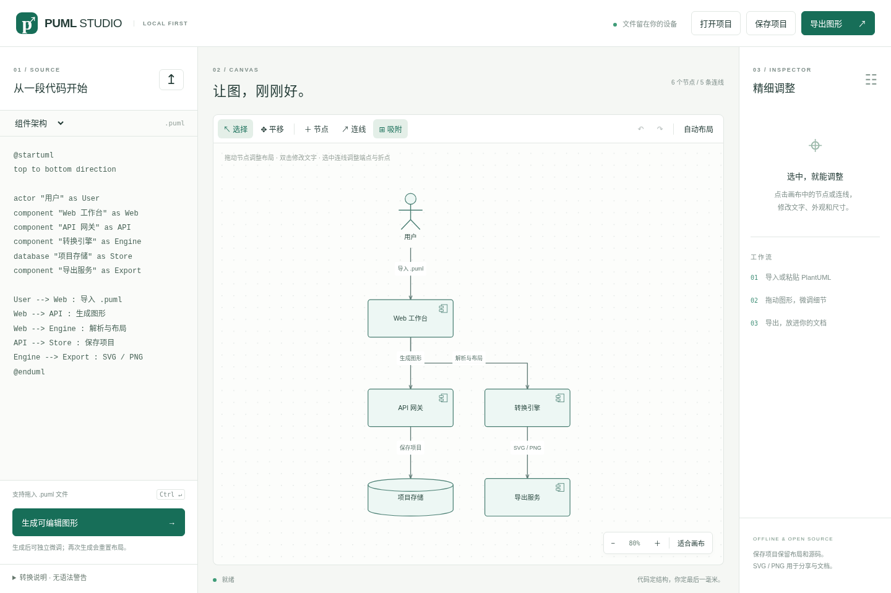
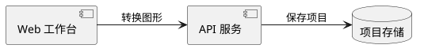
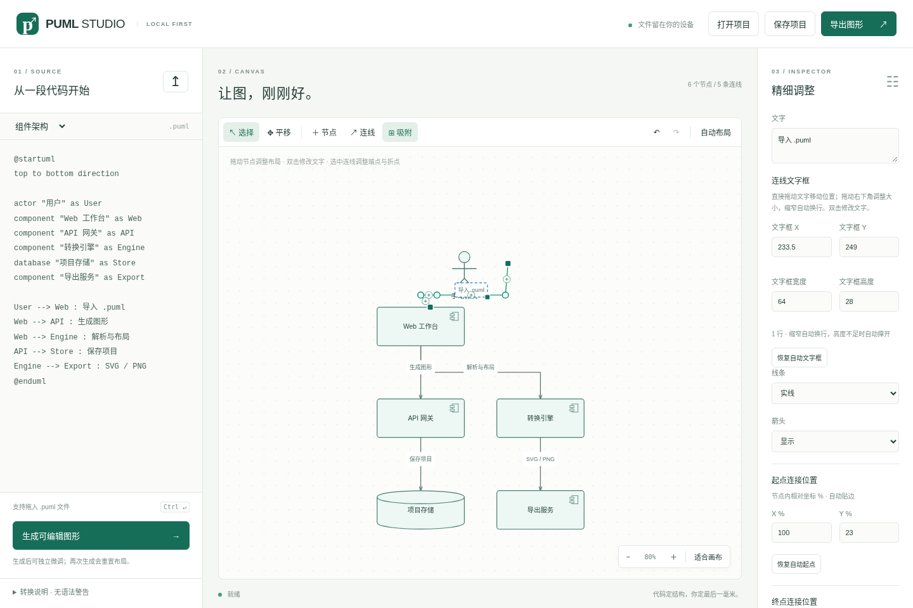
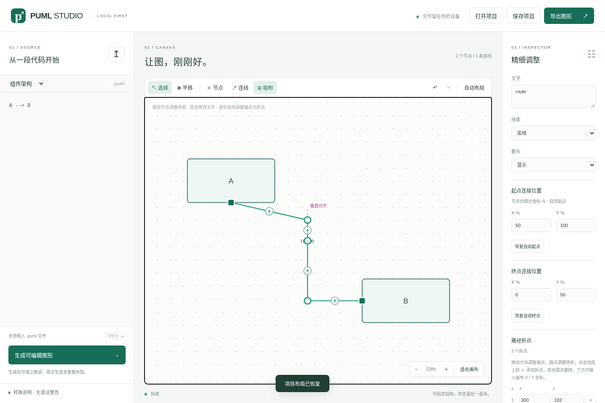
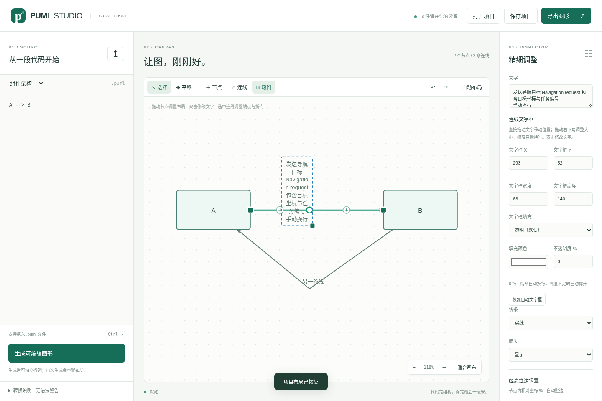

# PUML Studio

### 代码定结构，手动定细节。

将 PlantUML 转成**独立可编辑的节点、连线和文字框**。在浏览器中微调，再导出 SVG、PNG 或原生 draw.io 文件。

**离线运行 · 无后端 · 无须构建 · MIT 开源**

[English](README.md) · [示例](examples) · [语法支持范围](docs/syntax.md) · [精细连线编辑](docs/edge-editing.md) · [连线文字框](docs/edge-labels.md)



## 为什么做这个工具？

用 PlantUML 描述图的结构很方便。但在放进文档之前，往往还需要挪一个框、调整一条线的连接位置，或者让一段文字恰好放进有限的空间。

PUML Studio 将这些步骤放在同一个本地工作台中：

```text
.puml → 解析与布局 → 拖动、对齐、调整文字 → SVG / PNG / .drawio
                          ↕
                   保存 / 打开 .pumlstudio
```

生成后，节点、连线端点、中间折点和文字框都是可以独立编辑的对象。

> 当前支持 PlantUML 的一个实用子集，使用自己的解析器与布局算法，不调用 PlantUML 渲染引擎。复杂图请先阅读[支持范围](#支持范围)。

## 快速开始

1. 下载项目源码并解压。
2. 用现代桌面浏览器打开 **`index.html`**。
3. 拖入 `.puml` 文件、粘贴源码，或选择内置示例。
4. 点击「**生成可编辑图形**」，检查转换提示后开始微调。
5. 保存项目，或导出完成的图形。

日常使用不需要 Node.js、Java、Graphviz、API Key 或网络连接。当前界面为中文。

如果浏览器限制直接打开本地文件时的存储或下载，在**项目根目录**运行：

```bash
python3 -m http.server 8787
```

然后打开 **http://localhost:8787**。也可以使用其他静态 HTTP 服务器。

### 试试这段代码



更多示例：[组件架构](examples/architecture.puml)、[类图](examples/classes.puml)、[线性活动流程](examples/activity.puml)。

## 可以调整什么？

| 功能 | 操作方式 |
| --- | --- |
| 节点 | 拖动、缩放，修改形状、颜色、文字和类成员 |
| 连线 | 新增、删除，修改箭头及实线/虚线 |
| 起点与终点 | 拖动端点方块，或输入相对节点的 X/Y 百分比 |
| 中间折点 | 拖动圆点；点击线段上的「＋」插入；双击圆点删除 |
| 自动对齐 | 折点水平/垂直吸附，节点边缘和中心对齐 |
| 连线文字 | 独立拖动、调整宽高，精确输入位置与尺寸 |
| 自动换行 | 缩窄文字框后中英文自动换行，高度不足时自动撑开 |
| 文字框填充 | 默认透明，可自选颜色和背景不透明度 |
| 画布 | 缩放、平移、适合画布、自动布局、撤销/重做 |
| 项目文件 | 将源码和手工修改后的图形一起保存，之后继续编辑 |

吸附范围为**屏幕上的 8 像素**，缩放画布后保持一致。吸附时显示紫色参考线，按住 **Alt** 临时关闭，也可点击工具栏「吸附」开关。右侧输入坐标不受吸附影响。

<details>
<summary>查看精细连线编辑与自动吸附</summary>





具体坐标规则及恢复自动路径的行为，见[连线编辑说明](docs/edge-editing.md)。

</details>

<details>
<summary>查看可缩放文字框与自动换行</summary>



拖动文字移动位置，拖动右下角调整尺寸。背景不透明度只影响填充，不影响文字。详见[文字框说明](docs/edge-labels.md)。

</details>

## 保存与导出

| 格式 | 用途 |
| --- | --- |
| `.pumlstudio` | 在本工具中继续编辑，保留源码、布局、端点、折点及文字框设置 |
| `.svg` | 矢量图，适合文档及后续矢量编辑 |
| `.png` | 2 倍分辨率图片 |
| `.drawio` | 原生节点、连线和文字单元，可在 diagrams.net 中继续微调 |

点击「保存项目」下载项目文件，通过「打开项目」恢复。「导出图形」菜单提供 SVG、PNG 和 draw.io。SVG/PNG 使用当前画布的布局与换行结果，移到连线远处的文字框也会包含在导出范围中。

**手动修改不会反写 `.puml` 源码。** 再次生成会按源码重建图形并重置手工修改。继续微调请保存 `.pumlstudio`；SVG、PNG 和 draw.io 属于导出格式，当前不能作为项目重新导入本工具。

浏览器存储可用时会保存本机草稿。清理浏览器数据会删除草稿，重要修改请保存为项目文件。通过 `file://` 打开时，不同浏览器的草稿存储行为可能不同。

## 支持范围

| 输入 | 当前行为 |
| --- | --- |
| 组件/部署关系图 | 常见节点声明、别名和连接关系转为独立对象 |
| 类图 | 类、接口及纯文本成员分区 |
| 活动图 | **线性** `start → :活动; → stop` 流程 |
| 文字与关系 | 中文/Unicode 名称、引号标签、别名、前向引用、虚线及无向关系 |
| 布局方向 | 从左到右或从上到下；布局会处理循环依赖 |
| 容器 | 不保留容器边框，内部节点展开为平级，显示转换提示 |
| 特殊箭头 | 继承/组合等端点与方向提示会简化，显示转换提示 |
| 样式与预处理 | 不渲染或执行 `skinparam`、主题、注释、宏及 include |
| 时序图 | 尚不支持时间轴和生命线；消息可能被解析为普通结构关系 |
| 活动分支与循环 | 尚未实现 |

不支持或被简化的语句会显示行号提示，请检查提示及转换结果。输出不会完全复现 PlantUML 的布局或所有语义。完整规则见[语法说明](docs/syntax.md)。

## 本地运行与隐私

编辑器全部在浏览器内运行，无运行时网络请求、远程渲染服务、账号、统计脚本或 CDN 依赖。文件不会上传，项目下载和浏览器草稿均保存在本机。

界面主要面向桌面使用。字体取决于设备本地环境，不同设备或 draw.io 中的文字显示可能略有差异。

## 快捷键

| 操作 | 快捷键 |
| --- | --- |
| 根据源码生成 | Ctrl / Cmd + Enter |
| 撤销 | Ctrl / Cmd + Z |
| 重做 | Ctrl / Cmd + Shift + Z |
| 保存项目 | Ctrl / Cmd + S |
| 平移 | 空格加拖动、鼠标中键拖动，或平移工具 |
| 缩放 | 鼠标滚轮 |
| 删除选中元素 | Delete / Backspace |
| 退出连线模式、取消选中 | Esc |
| 临时跳过吸附 | 拖动时按住 Alt |

保存、撤销/重做和删除快捷键在文字输入区外生效；输入区保留正常的文本编辑快捷键。

## 开发与测试

项目使用原生 HTML、CSS、JavaScript 和 SVG，**没有构建步骤**。Node.js 仅用于开发测试，CI 使用 Node.js 22。

```bash
npm ci
npm test
npx playwright install chromium
npm run test:browser
```

也可以使用已有 Chromium：

```bash
CHROME_PATH=/path/to/chrome npm run test:browser
```

测试覆盖解析、项目校验、换行、吸附，以及浏览器中的拖动、缩放、文字编辑、撤销重做、项目恢复、实际文件下载和原生 draw.io 单元。浏览器测试通过 `file://` 打开页面，并检查无网络请求。截图与导出样例写入忽略提交的 `test-results/`。

| 文件 | 职责 |
| --- | --- |
| `index.html`、`style.css` | 界面与响应式样式 |
| `parser.js` | PlantUML 子集解析、提示、布局与项目数据校验 |
| `app.js` | SVG 编辑、交互、历史、保存与导出 |
| `snapping.js` | 与缩放比例一致的折点和节点吸附 |
| `label-layout.js` | 文字换行与标签尺寸计算 |
| `examples/` | PlantUML 示例 |
| `tests/` | 单元与浏览器集成测试 |
| `.github/workflows/test.yml` | push 和 pull request 时运行测试 |

## 静态部署

将项目根目录中的 `index.html` 及相邻资源部署到任意静态托管服务即可，不需要后端、环境变量或构建产物。不要上传 `node_modules/` 和 `test-results/`。

使用 GitHub Pages 时，将 `main` 分支的仓库根目录设为发布来源；使用其他分支名时选择对应分支。项目附带的 Actions 工作流只运行测试，不自动部署网站。

## 参与贡献

欢迎提交包含**最小 `.puml` 示例**、预期行为与浏览器信息的 Issue。修改解析器时，请补充对应的回归测试，并为不支持的语义保留明确提示。

后续可扩展方向：

- [ ] 嵌套容器与分组布局
- [ ] 正交线段联动与端口重连
- [ ] 活动分支与循环
- [ ] 专用时序图编辑器
- [ ] 英文界面与画布对象的键盘导航

如果这个工具帮你省下了调整图形的时间，欢迎点一个 Star，让更多人发现它。

## 许可证

[MIT](LICENSE)。PUML Studio 为独立实现，不包含 PlantUML 引擎或 `plantuml-to-drawio` 的代码。PlantUML 与 diagrams.net/draw.io 是各自独立的项目。
